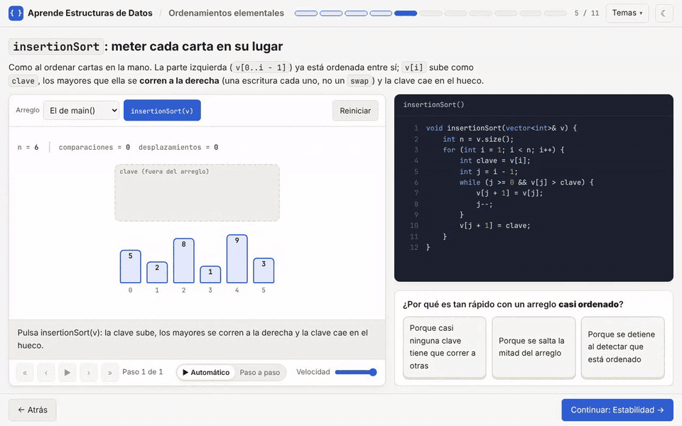

# Aprende Estructuras de Datos

Lecciones interactivas para entender las estructuras de datos **viendo qué pasa en memoria**: cada operación se anima paso a paso, junto a la línea de C++ que se está ejecutando.

### 👉 [Abrir el sitio](https://jmoisesct.github.io/learn-data-structures/)



Las ideas sirven para cualquier lenguaje; por ahora los ejemplos están en C++.

## Cómo es cada lección

- **Pasos cortos, uno a la vez**, que empiezan con la idea y una analogía.
- **Una animación por operación** (insertar, eliminar, buscar…): los valores se deslizan, lo nuevo aparece, lo que se borra se desvanece y los punteros se mueven. Ves la línea de C++ que corre, en qué vuelta va cada bucle y desde dónde se llamó cada función. Puedes pausar, avanzar y retroceder.
- **Preguntas con respuesta inmediata** para comprobar que entendiste.
- Al final, **complejidad (Big-O)**, cuándo conviene usar la estructura y **el programa completo en C++** listo para compilar, con ejercicios.

## Temas

| Tema | Qué vas a ver | Código |
| --- | --- | --- |
| **Fundamentos** | | |
| [Notación algorítmica](https://jmoisesct.github.io/learn-data-structures/temas/notacion-algoritmica/) | Big-O con una carrera de curvas: O(1), O(log n), O(n), O(n log n), O(n²) | [`.cpp`](ejemplos/cpp/notacion_algoritmica.cpp) |
| [Recursión](https://jmoisesct.github.io/learn-data-structures/temas/recursion/) | La pila de llamadas: sacar dígitos, cambio de base, palíndromos, Fibonacci con memoria | [`.cpp`](ejemplos/cpp/recursion.cpp) |
| [Lambdas en C++](https://jmoisesct.github.io/learn-data-structures/temas/lambdas/) | Capturas por valor y por referencia, `count_if`, `find_if` y `sort` con criterio | [`.cpp`](ejemplos/cpp/lambdas.cpp) |
| **Estructuras lineales** | | |
| [Vector dinámico](https://jmoisesct.github.io/learn-data-structures/temas/vector-dinamico/) | Acceso en O(1), redimensionar y costo amortizado | [`.cpp`](ejemplos/cpp/vector_dinamico.cpp) |
| [Lista enlazada](https://jmoisesct.github.io/learn-data-structures/temas/lista-enlazada/) | Nodos y punteros: insertar, buscar y eliminar | [`.cpp`](ejemplos/cpp/lista_enlazada.cpp) |
| [Lista doblemente enlazada](https://jmoisesct.github.io/learn-data-structures/temas/lista-doble/) | Cabeza y cola, extremos en O(1), los cuatro punteros al insertar | [`.cpp`](ejemplos/cpp/lista_doble.cpp) |
| [Lista circular](https://jmoisesct.github.io/learn-data-structures/temas/lista-circular/) | El último apunta al primero, rotar en O(1), turnos round-robin | [`.cpp`](ejemplos/cpp/lista_circular.cpp) |
| [Pila](https://jmoisesct.github.io/learn-data-structures/temas/pila/) | `std::stack`, paréntesis balanceados y una pila sobre nodos | [`.cpp`](ejemplos/cpp/pila.cpp) |
| [Cola](https://jmoisesct.github.io/learn-data-structures/temas/cola/) | `std::queue`, el problema de Josefo y una cola sobre nodos | [`.cpp`](ejemplos/cpp/cola.cpp) |
| **Ordenamiento** | | |
| [Ordenamientos elementales](https://jmoisesct.github.io/learn-data-structures/temas/ordenamiento-elemental/) | Exchange, bubble, selection, insertion y shell sort; estabilidad | [`.cpp`](ejemplos/cpp/ordenamiento_elemental.cpp) |
| [Merge sort y quicksort](https://jmoisesct.github.io/learn-data-structures/temas/merge-sort-quicksort/) | Mezclar, particionar, el peor caso y quickselect | [`.cpp`](ejemplos/cpp/merge_sort_quicksort.cpp) |
| [Ordenamientos sin comparaciones](https://jmoisesct.github.io/learn-data-structures/temas/ordenamiento-sin-comparaciones/) | Counting, radix y bucket sort | [`.cpp`](ejemplos/cpp/ordenamiento_sin_comparaciones.cpp) |
| [Montículo y heapsort](https://jmoisesct.github.io/learn-data-structures/temas/monticulo/) | Min-heap y max-heap: heapify, insertar, extraer y heapsort | [`.cpp`](ejemplos/cpp/monticulo.cpp) |
| **Búsqueda** | | |
| [Tabla hash](https://jmoisesct.github.io/learn-data-structures/temas/tabla-hash/) | Funciones hash, encadenamiento, sondeo y rehash | [`.cpp`](ejemplos/cpp/tabla_hash.cpp) |
| [Búsqueda binaria](https://jmoisesct.github.io/learn-data-structures/temas/busqueda-binaria/) | Iterativa y recursiva, `lowerBound`, `upperBound` y búsqueda sobre la respuesta | [`.cpp`](ejemplos/cpp/busqueda_binaria.cpp) |
| **Árboles y grafos** | | |
| [Árbol binario de búsqueda](https://jmoisesct.github.io/learn-data-structures/temas/arbol-binario-busqueda/) | Buscar, insertar, recorridos y eliminar en sus tres casos | [`.cpp`](ejemplos/cpp/arbol_binario_busqueda.cpp) |
| [Árbol AVL](https://jmoisesct.github.io/learn-data-structures/temas/arbol-avl/) | Factor de balance, rotaciones simples y dobles | [`.cpp`](ejemplos/cpp/arbol_avl.cpp) |
| [Grafos](https://jmoisesct.github.io/learn-data-structures/temas/grafos/) | Lista de adyacencia, BFS, DFS y componentes conexas | [`.cpp`](ejemplos/cpp/grafos.cpp) |

Los próximos temas están en [ROADMAP.md](ROADMAP.md).

## Usarlo en tu computadora

Compilar y ejecutar un ejemplo:

```bash
g++ -std=c++17 -Wall -Wextra ejemplos/cpp/pila.cpp -o pila && ./pila
```

Ver el sitio sin conexión (desde la carpeta del repositorio):

```bash
python3 -m http.server 8000
```

Luego abre http://localhost:8000. También puedes abrir `index.html` con doble clic: todo funciona salvo el bloque "Código completo", que el navegador solo carga con un servidor.

## Contribuir

¿Encontraste un error o tienes una idea? Abre un [issue](https://github.com/JMoisesCT/learn-data-structures/issues). Si quieres aportar código o un tema nuevo, lee [CONTRIBUTING.md](CONTRIBUTING.md).

---

Hecho por [Moisés C.](https://github.com/JMoisesCT)
